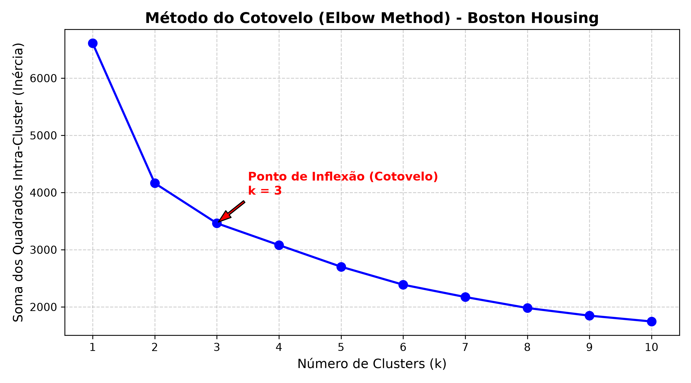

# AV2 - Avaliação de Machine Learning: Clusterização com K-Means

**Repositório Oficial:** [https://github.com/Bahryz/AV2-Escobar---K-Means](https://github.com/Bahryz/AV2-Escobar---K-Means)  
**Dataset:** Boston Housing (`HousingData.csv`)  
**Algoritmo:** K-Means Clustering (Aprendizado Não-Supervisionado)  

---

## 👨‍🏫 Visão Geral e Fundamentação Teórica

Este projeto implementa um pipeline completo de Machine Learning não-supervisionado para agrupamento (clusterização) de imóveis e regiões suburbanas de Boston, utilizando o algoritmo **K-Means**.

O sistema está estruturado em dois módulos fundamentais:
1. **Módulo de Treinamento**: Carga, tratamento de valores faltantes, normalização seletiva, determinação do número ótimo de grupos ($k$) pelo Método do Cotovelo e persistência do modelo e transformadores.
2. **Módulo de Inferência**: Entrada de características de uma nova residência, aplicação das transformações aprendidas, inferência do grupo e exibição do centroide desnormalizado para a escala real original.

---

## 📌 Critérios e Decisões Metodológicas

### 1. Normalização Cuidadosa: Dados Categóricos vs. Quantitativos
* **Por que normalizar?**  
  O algoritmo K-Means é baseado no cálculo da distância Euclidiana:
  $$d(p, q) = \sqrt{\sum_{i=1}^{n} (p_i - q_i)^2}$$
  Variáveis quantitativas com grandezas numéricas elevadas (como `TAX` que varia de 180 a 700, ou `B` que atinge quase 400) dominariam totalmente a função de custo em relação a variáveis de escala pequena (como `NOX`, que varia entre 0.38 e 0.87, ou `RM`, entre 3 e 9).
* **O cuidado com dados categóricos:**  
  A variável `CHAS` (Charles River) é uma variável binária (*dummy*): vale `1` se o lote faz fronteira com o rio e `0` caso contrário.
  Se aplicássemos padronização Z-score (`StandardScaler`) em `CHAS`, ela seria centrada na média ($\approx 0.07$) e dividida pelo desvio padrão ($\approx 0.25$). O valor $0$ viraria $-0.28$ e o valor $1$ viraria $+3.72$, fazendo com que a distância quadrática entre ter ou não saída para o rio assumisse um peso desproporcional ($\approx 16.0$) na distância euclidiana.  
  **Solução Adotada:** Criamos um pipeline com a classe `BostonPreprocessor` que aplica `StandardScaler` **exclusivamente nas variáveis quantitativas contínuas**, preservando `CHAS` como variável indicadora $\{0, 1\}$.

### 2. Por que NÃO há necessidade de balancear a base?
* Em **Aprendizado Supervisionado** (classificação), bases desbalanceadas podem induzir o modelo a privilegiar a classe majoritária.
* No **Aprendizado Não-Supervisionado (Clustering)**, não existem classes ou rótulos prévios (*ground truth*). O objetivo do K-Means é descobrir a topologia natural e a densidade intrínseca dos dados no hiperespaço. Se na vida real apenas uma pequena fração das casas possui alto padrão e muitas suítes, é natural, esperado e desejável que o cluster correspondente concentre menos amostras.

### 3. Método do Cotovelo (Elbow Method) e Número Ótimo de Grupos
* Calculamos a Inércia (WCSS - *Within-Cluster Sum of Squares*) para $k \in [1, 10]$:
  $$\text{WCSS} = \sum_{j=1}^{k} \sum_{x_i \in C_j} \|x_i - \mu_j\|^2$$
* Avaliamos a curva de decaimento da inércia:
  - $k=1 \rightarrow \text{WCSS} \approx 6609.72$
  - $k=2 \rightarrow \text{WCSS} \approx 4163.32$ (redução de $\approx 2446$)
  - $k=3 \rightarrow \text{WCSS} \approx 3462.89$ (redução de $\approx 700$)
  - $k=4 \rightarrow \text{WCSS} \approx 3081.12$ (redução de $\approx 381$)
  - A partir de $k=3$, o ganho marginal estabiliza (cotovelo bem definido).
* O ponto de inflexão ocorre nitidamente em **$k = 3$**, separando a base em 3 perfis socioeconômicos e imobiliários distintos.



### 4. Perfis Identificados pelos 3 Clusters (Escala Real Desnormalizada)
* **Cluster 0 (Alto Padrão / Luxo):**
  - Média de Quartos (`RM`): $\approx 7.03$
  - Valor Mediano (`MEDV`): $\approx \$32.82\text{k}$
  - Taxa de Criminalidade (`CRIM`): $\approx 0.20$ (muito baixa)
  - Impostos (`TAX`): $\approx 294.4$
* **Cluster 1 (Padrão Médio / Subúrbio Tradicional):**
  - Média de Quartos (`RM`): $\approx 6.11$
  - Valor Mediano (`MEDV`): $\approx \$21.50\text{k}$
  - Taxa de Criminalidade (`CRIM`): $\approx 0.35$ (baixa)
  - Impostos (`TAX`): $\approx 308.8$
* **Cluster 2 (Regiões Densas / Periféricas / Alta Taxa de Impostos):**
  - Média de Quartos (`RM`): $\approx 5.96$
  - Valor Mediano (`MEDV`): $\approx \$16.27\text{k}$
  - Taxa de Criminalidade (`CRIM`): $\approx 10.12$ (alta criminalidade)
  - Impostos (`TAX`): $\approx 626.4$

---

## 🛠️ Tecnologias e Bibliotecas Utilizadas

- **Python 3.12+**
- **pandas** e **numpy**: Manipulação e vetorização de matrizes de dados
- **scikit-learn**:
  - `KMeans`: Algoritmo de agrupamento
  - `StandardScaler`: Normalização das variáveis quantitativas
  - `SimpleImputer`: Tratamento de valores ausentes
  - `silhouette_score`: Métrica de validação de clusters
- **matplotlib**: Geração do gráfico do cotovelo
- **joblib**: Serialização e persistência do modelo e do pipeline de pré-processamento

---

## 🚀 Como Executar o Projeto

1. **Clonar o Repositório:**
   ```bash
   git clone https://github.com/Bahryz/AV2-Escobar---K-Means.git
   cd AV2-Escobar---K-Means
   ```

2. **Instalar Dependências:**
   ```bash
   pip install pandas numpy scikit-learn matplotlib joblib
   ```

3. **Executar o Treinamento e Inferência:**
   ```bash
   python cluster-kmeans.py
   ```

---

## 📂 Arquivos Gerados pelo Pipeline

- `cluster-kmeans.ipynb`: **Jupyter Notebook interativo** com toda a explicação didática passo a passo, gráficos renderizados e saídas executadas.
- `cluster-kmeans.py`: Código-fonte completo em Python com os módulos de treinamento e inferência.
- `metodo_cotovelo.png`: Gráfico gerado automaticamente demonstrando o cotovelo em $k=3$.
- `modelo_kmeans.joblib`: Modelo K-Means treinado e serializado.
- `preprocessor.joblib`: Objeto com imputers e scalers ajustados na base de treino.
